# Guía para el Estudiante: Diagramas de Casos de Uso con PlantUML

Esta guía detalla las reglas de sintaxis de PlantUML requeridas para aprobar con éxito las pruebas automáticas de cada ejercicio.

---

## 1. Conceptos Fundamentales de PlantUML

### Delimitadores de Diagrama
Todo archivo PlantUML debe iniciar y finalizar con las etiquetas obligatorias:

```plantuml
@startuml
...
@enduml
```


### Orientación
Para que los diagramas de casos de uso se organicen horizontalmente (actores a los lados y casos de uso al centro), se utiliza:
```plantuml
left to right direction
```

---

## 2. Modelado de Elementos

### Actores
Se pueden declarar con la palabra clave `actor` o con sintaxis de dos puntos:
```plantuml
actor "Cliente" as C
actor "Cajero" as CA
```

### Casos de Uso
Se encierran entre paréntesis o con la palabra clave `usecase`:
```plantuml
usecase "Consultar Saldo" as UC1
usecase "Retirar Efectivo" as UC2
```

### Paquetes y Límites del Sistema
Para delimitar el alcance del sistema o subsistemas se usan `package` o `rectangle`:
```plantuml
package "Sistema Bancario" {
    usecase "Consultar Saldo" as UC1
    usecase "Retirar Efectivo" as UC2
}
```

---

## 3. Relaciones y Conexiones

### Asociación Directa
```plantuml
C --> UC1
CA --> UC2
```

### Relaciones con Etiquetas
```plantuml
C --> UC_COMPRA : "Inicia proceso"
```

### Inclusión y Extensión
```plantuml
UC_COMPRA ..> UC_PAGO : <<include>>
UC_CUPON ..> UC_COMPRA : <<extend>>
```

### Generalización / Herencia entre Actores
```plantuml
actor Usuario as U
actor Estudiante as E
actor Profesor as P

U <|-- E
U <|-- P
```

---

## 4. Notas Explicativas

- **Nota anclada a elemento**:
  ```plantuml
  note right of UC_PAGO : Se requiere validación de fondos bancarios.
  ```
- **Nota sobre relación**:
  ```plantuml
  C --> UC1
  note on link : Requiere token de seguridad activo
  ```
- **Nota flotante con alias**:
  ```plantuml
  note "Los registros se guardan en bitácora de auditoría" as N1
  ```

---

## 5. Verificación de Tests

Ejecuta en tu terminal:
```bash
npm test ejercicio/1
npm test ejercicio/2
npm test ejercicio/3
npm test
```
